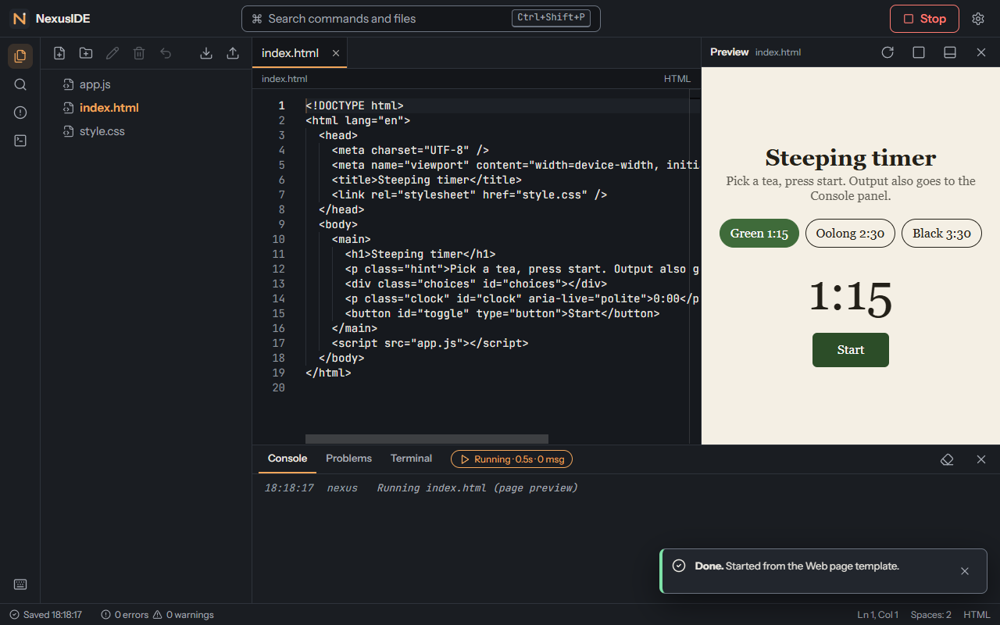

# NexusIDE

A browser IDE for **small web projects**. Edit HTML, CSS, JavaScript, TypeScript and React with Monaco, preview the
page, run console programs, and keep everything on your own device. Code you run executes in an isolated sandbox that has
no network access and no way to read the editor's data.



It is **not** VS Code: there is no Node, no npm install, no shell, no debugger, no extensions, no accounts, and no
server. See [docs/KNOWN_LIMITATIONS.md](docs/KNOWN_LIMITATIONS.md) before relying on it.

## Quick start

Requirements: Node 20.19 or newer, pnpm 11 (`npm install -g pnpm`), and a Chromium-based browser (developed and tested
on Microsoft Edge 156).

```bash
git clone <this repository> nexuside && cd nexuside
node scripts/bootstrap.mjs          # checks the toolchain, runs pnpm install --frozen-lockfile
pnpm dev                            # http://localhost:5173
```

For the real thing (security headers, offline mode, the exact artifact):

```bash
pnpm run build                      # -> dist/
pnpm preview                        # serves dist/ at http://localhost:4173
```

## Commands

| Command | What it does | Output |
|---|---|---|
| `node scripts/bootstrap.mjs [--verify]` | Checks Node and pnpm, installs from the lockfile; `--verify` also runs `pnpm run ci` | `node_modules/` |
| `pnpm dev` | Dev server with hot reload (no security headers; not for judging security) | http://localhost:5173 |
| `pnpm run build` | Type-check, production build, writes the offline service worker | `dist/` |
| `pnpm preview` | Serves `dist/` | http://localhost:4173 |
| `pnpm run verify-dist` | Checks the build (CSP, no CDN references, service worker list, sandbox policy) and prints hashes | console |
| `pnpm run format` / `format:check` | Prettier write / check (`src`, `e2e`, `scripts`) | in place |
| `pnpm run type-check` | `tsc --noEmit`, strict | console |
| `pnpm run lint` | ESLint with the complexity and size limits | console |
| `pnpm run contrast` | WCAG contrast of all design tokens and editor themes (136 checks) | console |
| `pnpm test` / `pnpm run test:coverage` | Vitest unit and component tests; coverage with per-layer gates | `coverage/` |
| `pnpm run e2e` | Browser tests (Edge) against `dist/` served by `vite preview`; `pnpm run e2e security` runs one suite | `docs/e2e-results.json`, `docs/screenshots/` |
| `pnpm run e2e:dev` | Browser tests against a separate dev server: StrictMode, hot-reload recovery, runnable templates on desktop and mobile, terminal output after remount | console |
| `pnpm run ci` | format check, types, lint, contrast, tests + coverage, build, verify-dist | console |
| `node scripts/test-report.mjs` | Rebuilds `docs/TEST_REPORT.md` from the raw results | `docs/TEST_REPORT.md` |

`pnpm run e2e` needs Microsoft Edge installed. In CI or on a machine without Edge:
`npx playwright-core install chromium` then `E2E_CHANNEL=chromium pnpm run e2e`.

## What you can do

* **Files**: Explorer with keyboard navigation, create / rename / delete with undo, tabs, search across files, Go to file.
* **Edit**: Monaco with diagnostics (Problems panel), autocomplete, format, themes (Graphite, Paper, high contrast,
  follow system), editor themes, font and indent settings.
* **Run**: `Ctrl+Enter`. A page runs in the preview pane; a `.js` / `.ts` file runs as a console program with timeouts.
  `Ctrl+Shift+Enter` stops. A JavaScript REPL lives in the Terminal tab.
* **Keep your work**: autosave to IndexedDB, crash recovery of unsaved edits, automatic backups before anything replaces
  your files, ZIP import and export.
* **Everywhere**: resizable panes, a phone layout with bottom navigation, works offline after the first load.

Press `Ctrl+Shift+P` (or `F1`) for every command and its shortcut, or `Ctrl+/` for the shortcut list.

### What runs

| Runs | Edit only (highlighting) |
|---|---|
| HTML, CSS, JavaScript, TypeScript, JSX/TSX, JSON imports, React 18.3.1 (bundled) | Markdown, XML/SVG, YAML, shell, Python, Rust, Go, Java, C, C++ |

Only `react`, `react-dom` and `react/jsx-runtime` can be imported; other packages cannot be installed. There is no network
inside the sandbox.

## Security in one paragraph

Every run happens in an iframe with `sandbox="allow-scripts allow-forms"` (opaque origin, no popups, no top
navigation) and a CSP of `default-src 'none'; connect-src 'none'; frame-src 'none'; form-action 'none'`. Console programs
run in a Worker inside that frame and are killed at a timeout; page previews have a heartbeat watchdog. Messages from
the sandbox are schema-checked and size-limited. The app shell itself ships a strict CSP (`script-src 'self'`). 20 hostile
page attempts and 8 hostile Worker attempts (network, storage, parent access, popups, frames, forms) are blocked, and
four ways of navigating the frame away are contained; all of it is verified against a real TCP server that records any
traffic (see S-01, S-02, S-10 in `docs/TEST_REPORT.md`). Details, evidence and the residual risks: [docs/ARCHITECTURE.md](docs/ARCHITECTURE.md).

## Your data

Everything is stored in your browser (IndexedDB and localStorage) and never uploaded; there is no telemetry and no
account. Clearing site data deletes it, so export a ZIP for anything important. Settings > Your data shows storage use,
backups and a delete-everything button.

## Layout of the repository

```
src/domain      pure logic: file tree, undo, search, run target, run state, settings (no DOM, no I/O)
src/services    IndexedDB, ZIP, sanitising of stored data
src/runtime     bundler, preview builder, sandbox host, runner, REPL, CSP and message protocol
src/store       Zustand stores, persistence coordinator, boot and recovery
src/editor      Monaco setup, per-file model registry, themes
src/components  React views (shell, files, editor, panels, dialogs, palette, search, preview)
src/app         commands, keymap, file / run / workspace actions
src/pwa         service worker generation and registration, sandbox warm-up
public          sandbox.html (the sandbox page), _headers, icon
scripts         bootstrap, contrast check, verify-dist, service worker template, test report generator
e2e             Playwright suites: core, security, resilience, responsive
docs            architecture, feature matrix, test report, release record, limitations, screenshots
```

## Documentation

| Document | Contents |
|---|---|
| [docs/ARCHITECTURE.md](docs/ARCHITECTURE.md) | components, domain model, state, persistence schema, sandbox design, **threat model**, permission matrix, decisions |
| [docs/FEATURE_MATRIX.md](docs/FEATURE_MATRIX.md) | every required feature: status and evidence |
| [docs/TEST_REPORT.md](docs/TEST_REPORT.md) | environment, test matrix, coverage, defects found and fixed |
| [docs/RELEASE.md](docs/RELEASE.md) | build, artifact path and hashes, hosting, rollback, fresh-clone verification |
| [docs/KNOWN_LIMITATIONS.md](docs/KNOWN_LIMITATIONS.md) | what it cannot do and what was not tested |
| [docs/DESIGN_REFERENCES.md](docs/DESIGN_REFERENCES.md) | design research record |
| [FEATURE_LOG.md](FEATURE_LOG.md) | change log per milestone |

## Fresh-clone verification checklist

1. `node scripts/bootstrap.mjs --verify` finishes with exit code 0 (installs, then runs the whole local gate).
2. `pnpm preview`, open http://localhost:4173, choose the **Web page** template, press **Run**: the steeping timer appears.
3. Open the browser's offline mode (DevTools > Network > Offline), reload: the app loads; press Run again: it still works.
4. `pnpm run e2e` (Edge installed): all checks pass; the run writes `docs/e2e-results.json`.

Status: v1.0.0. Browser-tested on Edge only; the commit gates in the specification were not performed because the working
rules say not to commit unless asked (see KNOWN_LIMITATIONS).
